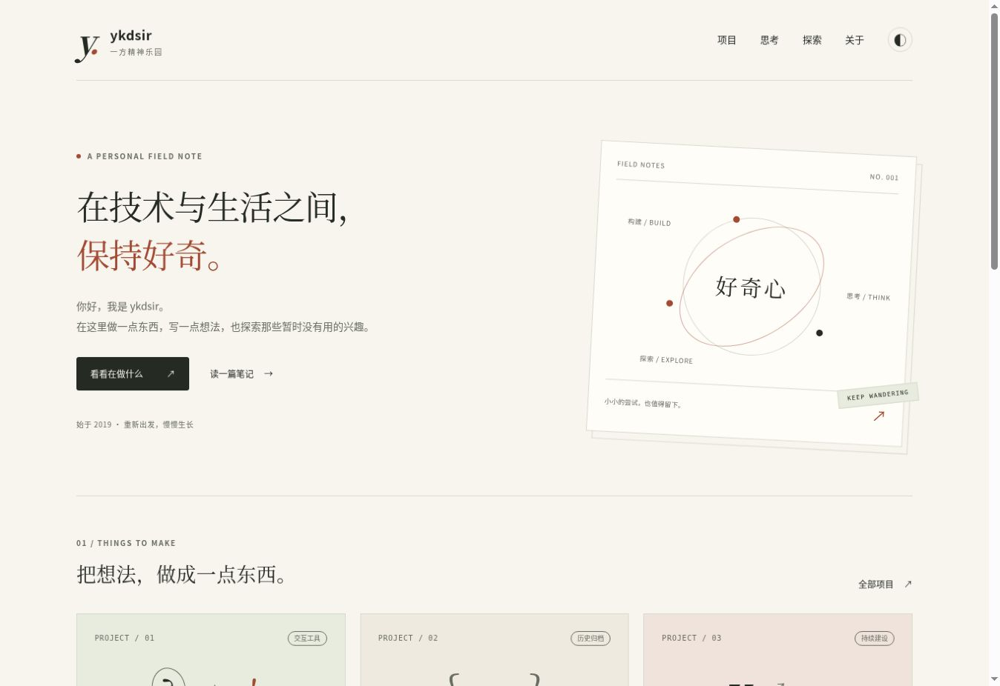

# ykdsir · 一方精神乐园

A small personal website for projects, notes and explorations.



## Work locally

Node.js 20 or later is sufficient; there are no package dependencies.

```sh
npm run build
npm run check
python3 -m http.server 8000 --directory dist
```

Open `http://localhost:8000`. Root HTML is also committed so the existing GitHub
Pages branch publishing workflow can continue without a hosting migration.
The `.nojekyll` marker serves the committed static files as-is.

## Content

| Location | Purpose |
| --- | --- |
| `_content/catalog.json` | Public article metadata and project cards |
| `_content/posts/` | Reviewed public article bodies in simple HTML |
| `_content/explorations/projects.json` | Twelve exploration exercises |
| `_content/legacy.json` | Original public article bodies and dates |
| `scripts/build.mjs` | Page templates, archive migration, feed and sitemap |
| `assets/` | Local styles, interactions and icon |

All new articles must have `visibility: "public"` and `privacy_reviewed: true`.
These flags record a review, not access control. All source files in this repository
are public. Keep private drafts out of Git entirely.

Build after every source change and commit the generated pages together with source.
The check command validates local links, old article URLs and a limited set of
privacy-sensitive patterns. Contextual review is required before pushing.

## Relaunch

The initial relaunch branch retains 13 original article URLs and dates, replaces
legacy navigation with the current archive, and removes the old profile template,
contact links, unused portrait asset and third-party counter scripts from the new
tree. Original algorithm content is preserved; remote images become explicit links
instead of automatically loading third-party resources. External legacy links and
old solutions are historical references, not freshly verified instructions.

Review and merge the relaunch PR to the existing publishing branch when ready. The
current Pages source has not been changed by this proposal. A repository permission
check alone does not confirm deployment settings; verify Pages build/deployment
after merging. Rollback is a normal revert, not a history rewrite.

Deleting a file from a new commit does not remove it from old Git history, forks,
caches or past deployments. No history rewrite is included.

See [editorial workflow](docs/editorial-workflow.md) for ongoing maintenance.
